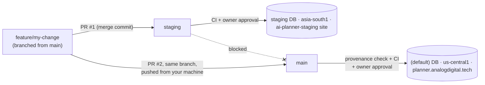

# Release flow: staging first, then main, never staging → main

AI Planner has two environments inside one Firebase project, `ai-planner-project-467800`.
Each environment has its own Firestore database, Cloud Functions region and Hosting site.

| Environment | Git branch | Firestore database | Functions | Hosting site / URL |
|---|---|---|---|---|
| Staging | `staging` | `staging` | `asia-south1` (codebase `staging`) | `ai-planner-staging` → https://ai-planner-staging.web.app |
| Production | `main` | `(default)` | `us-central1` (codebase `default`) | `ai-planner-project-467800` → https://planner.analogdigital.tech |

Shared by both: Firebase Auth users, Secret Manager, IAM and billing. A user who signs in on
staging also exists in production Auth, but their staging data lives only in the `staging`
database. Each environment's functions only accept requests from their own site.

How the split is wired:
- `.firebaserc` has two aliases, `staging` and `production`, for the same project. Deploying with
  `--project staging` loads `functions/.env.staging` (database, region, URLs); `--project production`
  loads `functions/.env.production`.
- `firebase.json` is the production config. `scripts/ci/firebase-config.js staging` derives
  `firebase.staging.json` from it (site, rewrite regions, functions codebase, database), so headers
  and rewrites can't drift between the two.
- `scripts/ci/deploy.sh` checks that the env file matches the target before deploying, and creates
  the `staging` database on first deploy.



## The rules

1. **Every change starts as a feature branch cut from `main`.** Never branch from `staging`:
   staging contains other people's unreleased work.
2. **First stop is staging.** Open a PR from the feature branch into `staging` and merge it with a
   **merge commit** (squash and rebase are turned off for the repo). The `Staging Deploy`
   workflow re-runs the tests and then waits for the owner to approve the deploy in the
   `staging` environment.
3. **Verify on staging.** Use https://ai-planner-staging.web.app with test accounts and
   the staging database (`npm run seed:staging` loads sample users into the `staging` database only).
4. **Then promote the same feature branch to main from your machine:**
   ```bash
   git checkout feature/my-change
   npm run promote            # = scripts/promote-to-main.sh
   ```
   This runs the branch-policy check locally, pushes the branch, and opens PR #2 into `main`.
   Merge it with a merge commit. The `Production Deploy` workflow re-checks provenance, runs the
   tests, and waits for the owner to approve the deploy in the `production` environment.
5. **`staging` never merges into `main`.** CI rejects:
   - a PR whose head branch is `staging`;
   - any branch that contains a staging merge commit (for example after `git merge staging`);
   - any commit that hasn't already been merged into staging.

   The same check runs again after every push to `main`, and production deploys are blocked if
   it fails.

## What enforces it

| Layer | File | What it does |
|---|---|---|
| PR check | `.github/workflows/pr-check.yml` → `scripts/ci/branch-policy.sh` | The "Branch Policy" required check on PRs into `main`/`staging` |
| Push check | `.github/workflows/production.yml` (job "Staging Provenance") | Re-runs the policy on what actually landed on `main` before any deploy |
| Approval | GitHub environments `staging` and `production` | The deploy job waits for the owner's approval; each environment only accepts its own branch |
| Tests | `.github/workflows/quality.yml` | The same suite on PRs, on staging pushes and on main pushes |
| Branch protection | `scripts/setup-repo-governance.sh` | PRs + CODEOWNERS review + required checks on `main` and `staging`; no force-push or delete |
| Local guard | `scripts/git-hooks/pre-push` (`npm run setup:hooks`) | Stops `git push origin main`/`staging` and pushing staging into main from your laptop |
| Deploy guard | `scripts/guard-deploy.sh` (Firebase `predeploy`) | `firebase deploy` only runs inside GitHub Actions; local deploys are refused |
| Cloud identity | `scripts/setup-gcp-oidc.sh` | Only the matching GitHub environment's jobs can impersonate each project's deploy account |

## One-time setup (owner)

```bash
gh auth status                              # must be a repo admin
scripts/setup-repo-governance.sh --dry-run  # review what will change
scripts/setup-repo-governance.sh            # staging branch, environments, protection, merge settings
npm run setup:hooks                         # local pre-push guard (each clone)

# Keyless deploys (recommended; replaces the FIREBASE_TOKEN secret)
scripts/setup-gcp-oidc.sh staging
scripts/setup-gcp-oidc.sh production
# then set the WIF_PROVIDER / SA_EMAIL environment variables it prints
```

Optional per-environment variables (Settings → Environments → *env* → Variables):
`FIREBASE_API_KEY`, `FIREBASE_APP_ID`, `FIREBASE_MESSAGING_SENDER_ID`, `FIREBASE_AUTH_DOMAIN`.
When absent, `scripts/ci/deploy.sh` reads the web config from the project (both environments use
the same web app).

**Solo owner:** GitHub never lets you approve your own pull request. As an admin you can merge
your own PRs with "Merge without waiting for requirements"; the deploy itself still waits for
your approval on the environment. PRs from anyone else need your review.

## Hotfixes and rollbacks

There is no shortcut around staging. For an urgent fix: branch from `main`, PR into `staging`,
approve the staging deploy, smoke-test, then `npm run promote` and approve production. That is
four clicks plus CI time.

To roll back: in Firebase Console → Hosting → Release history, roll back the site immediately.
Then `git revert` the bad merge on a new branch and ship the revert through the same flow.

## Keeping staging close to main

After a production release, staging can lag behind main's merge commits. Bring it up to date
with a PR from `main` into `staging` (main → staging is allowed; the reverse is not).
